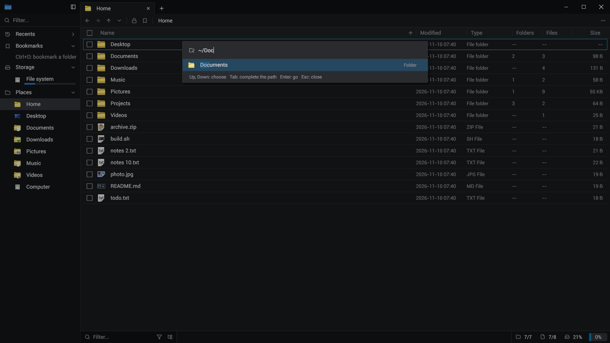
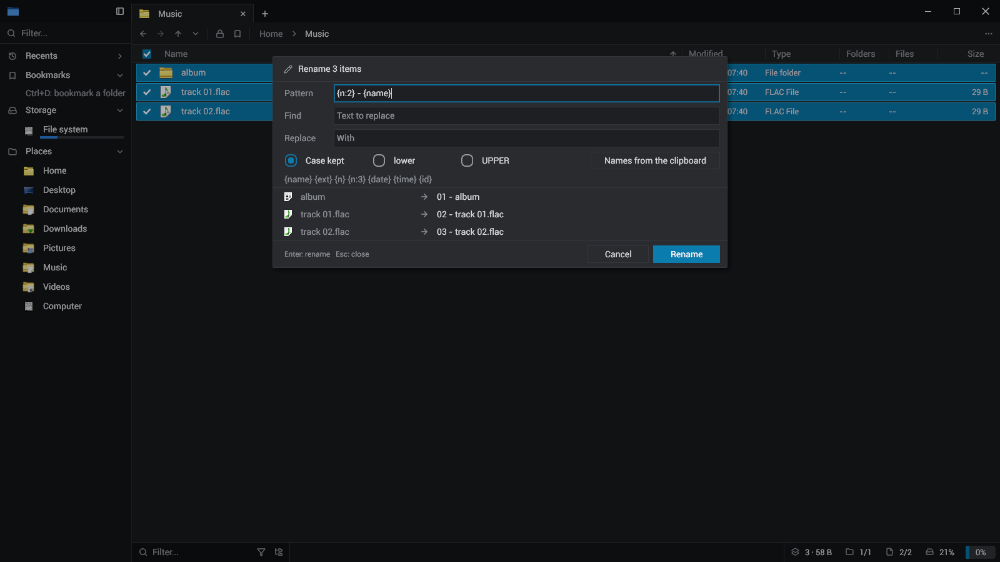

<p align="center"></p>

<h1 align="center">classeur</h1>

<p align="center"><b>A fast file manager for Linux and Windows.</b></p>

classeur shows your folders in tabs and panels, and does everything from the keyboard: a command palette, a filter as
you type, the path typed or clicked. It is one native program, written in [Odin](https://odin-lang.org) on
[gui_toolkit](https://github.com/sachahjkl/gui_toolkit), and its model is [File Pilot](https://filepilot.tech).


Its site: [classeur.sacha.house](https://classeur.sacha.house/).

## Features

- **Fast**: a folder is read on worker threads with the system's fastest calls, and only the rows in view are built. The
  window never waits for the disk.
- **Tabs and panels**: each panel's tabs at the top of the window, panels side by side; tabs dragged along their row, to
  another panel or to a new one. The session comes back at the next start; a second `classeur <folder>` opens a tab.
- **Zoom** (Ctrl+wheel): the details, the names alone, the names in columns, then cards with thumbnails, ever larger.
- **GoTo** (Ctrl+G): a path completed as you type, or a few letters of a recent folder, a bookmark, a place.
- **Search** (Ctrl+Shift+F): every file under a folder, flattened, filtered by a few letters in order (fuzzy). The types'
  popup keeps files or folders alone, or some extensions.
- **Batch rename** (F2 on several items): a pattern with numbers, dates and ids, find and replace, the case, the names
  from the clipboard.
- **Undo and redo** (Ctrl+Z, Ctrl+Y): renames, new folders and files, copies, moves, the trash.
- **Drag and drop**: rows out to any program as files, files from anywhere onto folders, lists, tabs and the sidebar; the
  rectangle selection.
- **Copy, cut, paste, trash** in a queue of jobs with their progress; a cut is a move for the other file managers too.
- **Folder sizes**: what each folder holds all the way down, its folders, files and bytes, measured as you look.
- **Command palette** (Ctrl+Shift+P) and **options** (Ctrl+,): every action and every option, found by typing. The menus
  are searched by typing too; "Open with", a terminal here (F4).
- **The sidebar**: recent folders, bookmarks (Ctrl+D), the volumes and how full they are, the places.
- **The system's icons**: the desktop's icon theme on Linux, the shell's on Windows.
- **Watched folders**: a change made by any program shows at once.

| | |
|---|---|
|  |  |
| The grid beside the details | GoTo |
|  |  |
| Batch rename | The search of a whole folder |
|  |  |
| The command palette | The options |

What comes next is in [docs/roadmap.md](docs/roadmap.md).

## Keys

| Key | |
|---|---|
| Enter, double click | open |
| Backspace, Alt+Up | the parent folder |
| Alt+Left, Alt+Right, the mouse's side buttons | back, forward |
| Ctrl+G | GoTo |
| Ctrl+L | type a path |
| Ctrl+F | filter |
| Ctrl+Shift+F | search every folder below |
| Ctrl+wheel, Ctrl+=, Ctrl+- | zoom: details, names, columns, cards |
| Space | the inspector |
| Ctrl+, | options |
| Ctrl+D | bookmark the folder |
| Ctrl+T, Ctrl+W, Ctrl+Shift+T | new tab, close it, open it again |
| Ctrl+Enter | the folder in a new tab |
| Ctrl+Shift+D, F6 | a new panel, the next panel |
| F2 | rename (several items: batch rename) |
| Ctrl+Shift+N, Ctrl+Alt+N | new folder, new file |
| Ctrl+Z, Ctrl+Y | undo, redo |
| F4 | a terminal here |
| Ctrl+H | hidden files |
| Ctrl+Shift+P, F1 | the command palette |

## Build

```sh
git clone --recurse-submodules https://github.com/sachahjkl/classeur && cd classeur
nix develop
./build.sh release      # build/classeur
```

Every step of the project is a command of `tools/classeurtool`: see [docs/development.md](docs/development.md).

## Licence

MIT, see [LICENSE](LICENSE). The icons of files are the system's (the icon theme on Linux, the shell's on Windows); the
buttons' icons are [Lucide](https://lucide.dev)'s, ISC.
